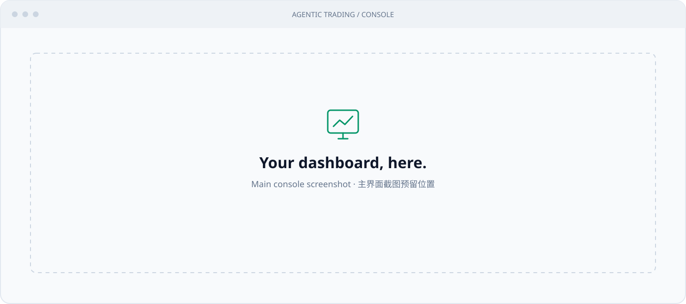

<p align="center">
  <strong>English</strong> · <a href="README.zh-CN.md">简体中文</a>
</p>

<h1 align="center">Agentic Trading</h1>

<p align="center">
  <strong>From multi-agent research to accountable execution.</strong><br />
  Portfolio-aware analysis, explicit risk limits, and a human approval console.
</p>

<p align="center">
  
  
  
</p>

<p align="center">
  <a href="#overview">Overview</a> ·
  <a href="#architecture">Architecture</a> ·
  <a href="#tech-stack">Tech stack</a> ·
  <a href="#engineering-decisions">Engineering</a> ·
  <a href="#quick-start">Quick start</a>
</p>

<!-- Replace the image below with docs/screenshots/dashboard.png when your main-console screenshot is ready. -->


<p align="center"><sub>Main console screenshot goes here.</sub></p>

## Overview

Give the system a ticker and portfolio context. Analysts gather market evidence, bull and bear researchers debate the thesis, and managers synthesize a structured decision. Deterministic policy and risk checks decide whether that decision can become an actionable proposal.

- **Research:** instrument-aware agent selection, portfolio constraints, analyst reports, and recorded tool calls.
- **Review & execute:** inspect a proposal, approve its exact terms, and revalidate current state before sending an order.
- **Personal assistant:** account-scoped holdings reviews, stock/ETF candidates, and persistent conversations. Personal accounts remain outside trading permissions.
- **Observe & evaluate:** follow jobs, orders, fills, and audit events; compare forward results with a declared passive benchmark.

The current live execution mode requires human approval. Research agents have data tools; execution authority stays in Python.

## Architecture


<sub>Built with <a href="https://github.com/tt-a1i/archify">Archify</a> · <a href="docs/architecture/system.html">Interactive HTML — download and open</a> · <a href="docs/architecture/system.architecture.json">Editable source</a> · <a href="docs/architecture/README.md">Rebuild & validation</a></sub>

**Research → proposal → approval → revalidation → submission → reconciliation.** A model recommendation is an input to this pipeline. `NO_TRADE`, expired evidence, rejected proposals, partial fills, and uncertain submissions all have explicit handling.

## Tech stack

| Layer | Technology | Role |
| --- | --- | --- |
| Runtime | **Python 3.12 · uv** | Typed application code, locked dependencies, and `ct-*` command-line tools. |
| Agent orchestration | **TradingAgents · LangGraph · LangChain** | Pinned upstream research graph; local portfolio context, analyst selection, and model/effort routing. |
| Model & tools | **Claude Code CLI · MCP Python SDK** | LangChain-compatible subscription-backed model adapter; allowlisted market, news, fundamental, and macro tools. |
| API & contracts | **FastAPI · Uvicorn · Pydantic v2** | HTTP/OpenAPI interface and validated models over a shared Python service layer. |
| State & configuration | **SQLite WAL · YAML · JSON/Markdown** | Transactional jobs, proposals, approvals, orders, and fills; reviewed configuration and inspectable research artefacts. |
| Console | **HTML · CSS · Vanilla JavaScript** | Bilingual, same-origin interface with shared polling and retained page state; no frontend build step. |
| Market & execution | **yfinance · FRED · exchange-calendars**; **simulated / Robinhood adapters** | Evidence retrieval, exchange sessions, and broker access behind deterministic execution checks. |
| Quality & operations | **pytest · Ruff · Node test runner · GitHub Actions · macOS launchd** | Offline checks, scheduled jobs, immutable releases, rollback, backups, and health monitoring. |

## Engineering decisions

[TradingAgents](https://github.com/TauricResearch/TradingAgents) provides the research graph and agent roles. It is pinned to a Git commit, never vendored or edited. This repository builds the application and control boundaries around it:

| Decision | Implementation and why it matters |
| --- | --- |
| **Separate reasoning from authority** | Pydantic decision records feed deterministic action mapping and hard risk rules. Confidence cannot override a limit. [Policy](agentic_trading/policy.py) · [Risk engine](agentic_trading/risk/engine.py) |
| **Constrain the model runtime** | The Claude Code adapter disables built-in tools, uses a strict MCP configuration, strips API-billing overrides, and captures tool traces. CLI failures surface without switching providers. [Adapter](agentic_trading/llm/claude_code.py) |
| **Revalidate at the money boundary** | Approval binds to a proposal version and exact terms. Execution refreshes portfolio and market state and checks risk again. The live order entry point is centralized and tested. [Approvals](agentic_trading/service/approvals.py) · [Boundary tests](tests/test_money_paths.py) |
| **Recover ambiguous execution** | Persist order intent before submission; use idempotency keys and transactional reservations. An uncertain result enters reconciliation instead of blindly resubmitting. Partial fills remain distinct from completed exits. [Execution](agentic_trading/execution.py) · [State](agentic_trading/state_db.py) |
| **Keep work durable and scoped** | SQLite-backed jobs use deduplication, concurrency limits, and explicit states. Personal accounts, the Agentic account, and demo research retain separate scopes. [Jobs](agentic_trading/research_jobs.py) · [Isolation tests](tests/test_account_scope.py) |
| **Measure decisions, not selected wins** | Forward evaluation freezes study settings, records no-trades and failures, separates demo/live samples, and adjusts returns for cash flows. Software tests establish behavior; they do not establish investment performance. [Evaluation](agentic_trading/evaluation.py) |

<details>
<summary>Research console preview · sample data</summary>


</details>

## Quick start

Requires **Python 3.12** and **[uv](https://docs.astral.sh/uv/)**. AI research additionally needs a signed-in Claude Code CLI with access to the models configured in `config/investor_profile.yaml`.

For a **fresh local clone**:

```bash
git clone https://github.com/heyemlee/agentic_trading.git
cd agentic_trading
uv sync --frozen

mkdir -p state runs
cp -n .env.example .env
cp -n config/examples/portfolio.example.yaml state/portfolio.yaml
cp -n config/examples/micro_live_portfolio.example.yaml state/micro_live_portfolio.yaml

uv run ct-auth   # create console credentials
uv run ct-api    # serve the API and console
```

Open [localhost:8787](http://127.0.0.1:8787/) and sign in. Stop the foreground server with Ctrl-C.

> **Before connecting a broker:** `config/` contains the owner's tracked deployment settings, including enabled live-execution gates. A fresh clone has no broker token and cannot submit a real order; the general broker adapter is simulated. Review [risk configuration](config/risk_profile.yaml) and the [operations guide](docs/OPERATIONS.md) before connecting an account. Do not set `ANTHROPIC_API_KEY`; research uses the Claude Code subscription login.

```bash
uv run ct-trigger manual --ticker VTI   # enqueue research; uses Claude subscription quota
uv run ct-trigger scheduled --dry-run   # inspect the schedule without starting research
uv run ct-state status                 # check state integrity and unsettled orders
uv run ct-ops status                   # check background-job health
```

Reports and decision records are saved under `runs/<run-id>/` and appear in the console. Optional `.env` settings include `FRED_API_KEY` for macro data, `CT_PUSH_SUBJECT` for web push, and `CT_HEARTBEAT_URL` for an external monitor.

## Development & docs

```bash
deploy/checks.sh  # Ruff + offline Python tests + frontend cases + secret scan
```

The suite uses fake model and broker runtimes. It requires no live credentials or model calls and guards against access to production state.

| Start here | Contents |
| --- | --- |
| [Application code](agentic_trading/) | Thin `api/`, shared `service/`, model adapters in `llm/`, deterministic `risk/` and `broker/` adapters. |
| [Console](ui/README.md) | Frontend architecture, data freshness, approval interaction, and bilingual UI. |
| [Personal assistant](docs/PERSONAL_ASSISTANT.md) | Holdings reviews, account scope, conversations, and capability boundaries. |
| [Operations](docs/OPERATIONS.md) | Configuration, execution controls, reconciliation, and recovery. |
| [macOS deployment](docs/MACOS_DEPLOYMENT.md) | launchd, releases, rollback, backups, and maintenance. |
