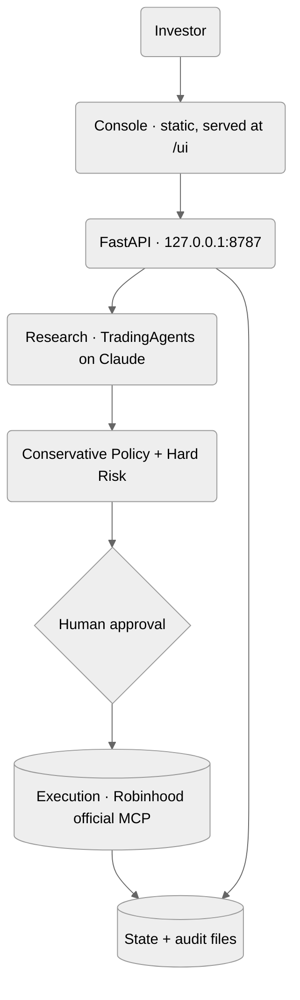

English | [简体中文](./README.zh-CN.md)

# Conservative Trading

A conservative, human-approved investment system for one investor.

An AI research pipeline studies a security, a deterministic risk layer decides what is
permitted, and you approve anything that touches money.

`Python 3.12` · `FastAPI` · `Local-only` · Real-money execution off by default

[Documentation](./docs/OPERATIONS.md) · [Quick Start](#getting-started) · [Frontend handoff](./docs/FRONTEND_HANDOFF.md)

<br />


<sub>The console, running on the bundled sample payloads. The amber strip is the product
working: sample data can never be mistaken for live data.</sub>

<br />

---

## Core Features

**No trade is a result**

The system is judged on capital preservation, not activity. A quiet queue means it looked and
declined — the outcome is recorded with its full reasoning.

**Deterministic risk, twice**

A rules layer runs at proposal time and again at execution time. It is plain Python, not a
model, and nothing in the interface can bypass it.

**Approval means "if it still holds"**

Approving authorises the idea, never a stored order. The backend re-reads the quote, the
portfolio and the risk state, then refuses if the world moved too far.

**Three isolated pools**

Core and Sandbox are conceptual. Micro-Live is real money at Robinhood, hard-capped at $100 in
four independent places. A bucket may only execute at its own venue.

**Every decision on the record**

Each run leaves the analyst reports, the bull and bear debate, the risk debate and the final
verdict. The console reads them back as an ordered trace.

<br />


<sub>A proposal, with the case, the blind spots and every risk rule it had to clear.</sub>

<br />


<sub>Decision strength against the trading floor, and every recorded run.</sub>

<br />

---

## Built On

Nothing here re-implements something that already exists.

**[TradingAgents](https://github.com/TauricResearch/TradingAgents)** — the multi-agent research
framework. Pinned to a commit, never vendored, never modified.

**Claude Code CLI** — the LLM runtime, on a Max subscription rather than a metered API key.

**[Model Context Protocol](https://modelcontextprotocol.io)** — the official Python SDK exposes
TradingAgents' data tools to that runtime, and nothing else.

**Robinhood Agentic Trading** — used through its official MCP server as a broker transport for
deterministic Python, never as a tool handed to a model.

**exchange-calendars** — NYSE sessions, holidays and half days, so execution never relies on a
hand-maintained calendar.

**FastAPI** — chosen for the OpenAPI schema it publishes; the console is built against that
contract rather than against prose.

<br />

---

## Tech Stack

**Backend**
Python 3.12 · FastAPI · Uvicorn · Pydantic

**Research**
TradingAgents · Claude Code CLI · Model Context Protocol

**Broker**
Robinhood Agentic Trading (official MCP) · simulated adapter

**Storage**
Plain files — YAML ledger, JSON risk state, JSONL fills. No database.

**Console**
Static HTML, CSS and JavaScript. No framework, no build step.

**Tooling**
uv · pytest · ruff

<br />

---

## Architecture



The research layer proposes. The risk layer permits. You approve. Execution re-reads the world
and may still refuse — a refusal is a correct result, not an error.

<br />

---

## Getting Started

### Requirements

- Python 3.12
- [uv](https://docs.astral.sh/uv/)
- Claude Code CLI, signed in — the research runtime
- A Robinhood account — only for the Micro-Live experiment

### Installation

```bash
git clone https://github.com/<owner>/agentic_trading.git
cd agentic_trading
uv sync
```

### Environment

```bash
cp .env.example .env
```

Every key in it is optional. Do not set `ANTHROPIC_API_KEY` — the LLM layer runs on your
subscription, and an API key would switch billing to pay-as-you-go.

### Run

```bash
uv run ct-api
```

```text
http://127.0.0.1:8787/ui/
```

The API and the console are one process on one origin. The OpenAPI schema is at `/docs`.

Command-line entry points, the broker connection and the risk configuration are covered in
[Documentation](./docs/OPERATIONS.md).

<br />

---

## License

No license has been declared for this repository yet. Until one is added, all rights are
reserved by the author.

TradingAgents and every other dependency remain under their own upstream licenses.
