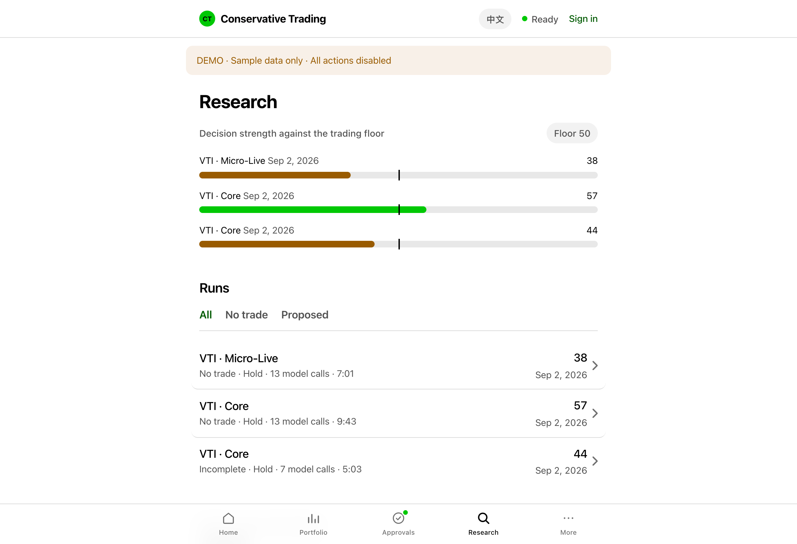

<p align="center">
  <a href="README.md">English</a> · <strong>简体中文</strong>
</p>

<h1 align="center">Agentic Trading</h1>

<p align="center">
  <strong>AI Agent 负责研究、辩论和提案，人来批准。</strong><br />
  一个理解持仓上下文、调用工具、输出结构化决策，并记录执行过程的多智能体系统。
</p>

<p align="center">
  <a href="#如何运行">系统架构</a> ·
  <a href="#我实现了什么">工程实现</a> ·
  <a href="#本地启动">快速开始</a>
</p>

## 项目思路

给一组 AI Agent 一个标的和你的持仓上下文：分析师收集证据，多空研究员质疑论点，管理者综合形成建议。系统将研究结果转成结构化提案，写明风险、缺失信息，以及采取行动或保持观望的理由。

核心设计问题是：**应该给 Agent 多大的权限？** 在这里，Agent 负责研究，确定性代码约束风险，执行前必须经过人工审批并重新检查当前状态。实盘交易默认关闭。

## 如何运行


<sub>使用 <a href="https://github.com/tt-a1i/archify">Archify</a> 绘制 · <a href="docs/architecture/system.html">交互版 HTML：下载后打开</a> · <a href="docs/architecture/system.architecture.json">图表源文件</a></sub>

## 我实现了什么

项目基于 [TradingAgents](https://github.com/TauricResearch/TradingAgents)，复用其研究图和 Agent 角色。我的工作是把这套研究流程接入完整应用：

| 方向 | 具体实现 |
| --- | --- |
| **Agent 编排** | 为各角色注入持仓上下文和投资约束；按标的类型选择分析师，为不同角色配置模型和推理强度。[代码](agentic_trading/graph.py) |
| **运行时与工具调用** | 实现兼容 LangChain 的 Claude Code 适配器，支持 MCP 数据工具白名单、结构化输出及工具调用记录。[代码](agentic_trading/llm/claude_code.py) |
| **决策权限边界** | 用 Pydantic 定义提案，通过确定性代码映射动作，在审批前和执行前分别检查风险。[策略](agentic_trading/policy.py) · [执行](agentic_trading/execution.py) |
| **可靠性与评估** | 持久化研究任务、幂等订单处理、SQLite 审计状态，以及对照被动基准的前瞻评估。[任务](agentic_trading/research_jobs.py) · [评估](agentic_trading/evaluation.py) |

离线测试通过模拟模型运行时验证 Agent 研究图，并覆盖工具隔离、策略失败和执行恢复。[查看测试 →](tests)

<details>
<summary>展开查看研究控制台</summary>



<sub>示例数据预览：通过网页控制台查看研究报告和决策。</sub>

</details>

## 个人投资助手

控制台新增「投资助手」：只读分析所有 Robinhood 账户的股票与 ETF，从已有自选和筛选结果接入候选，并结合个人档案、补充信息和历史研究进行连续聊天。复用原有研究和后台任务，普通账户不会获得交易权限。使用方法和能力边界见 [个人助手说明](docs/PERSONAL_ASSISTANT.md)。

## 本地启动

需要 **Python 3.12** 和 **[uv](https://docs.astral.sh/uv/)**。AI 研究还需要已登录的 Claude Code CLI，并能使用 `config/investor_profile.yaml` 中配置的模型。

```bash
git clone https://github.com/heyemlee/agentic_trading.git
cd agentic_trading
uv sync
cp -n .env.example .env
cp -n state/portfolio.example.yaml state/portfolio.yaml
cp -n state/micro_live_portfolio.example.yaml state/micro_live_portfolio.yaml
uv run ct-auth              # 创建本地控制台登录凭据
uv run ct-api
```

打开 [localhost:8787/ui/](http://127.0.0.1:8787/ui/)。券商连接和运行细节见[操作文档](docs/OPERATIONS.md)。

<sub>Python · TradingAgents / LangGraph · Claude Code · MCP · FastAPI · Pydantic · SQLite · 原生 JavaScript</sub>
