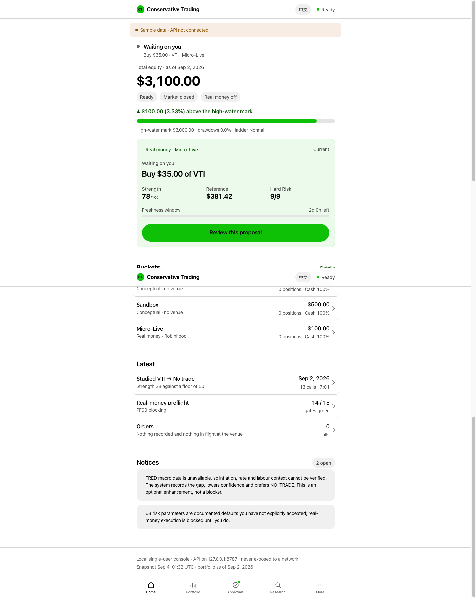
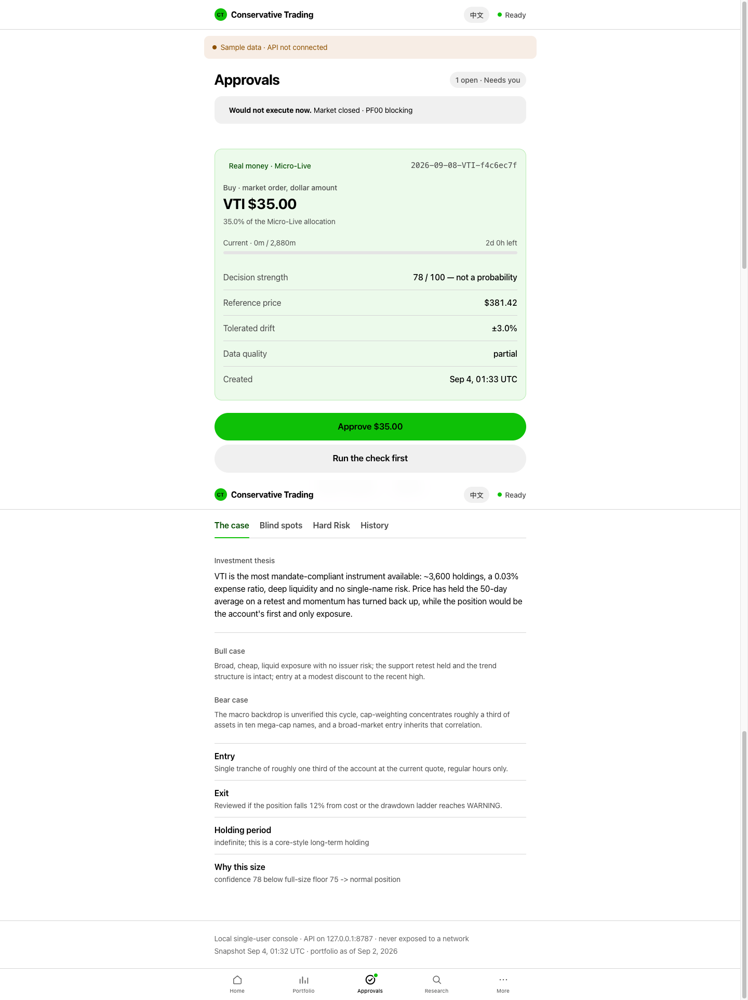
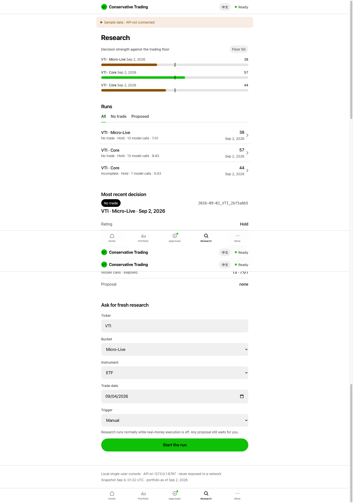
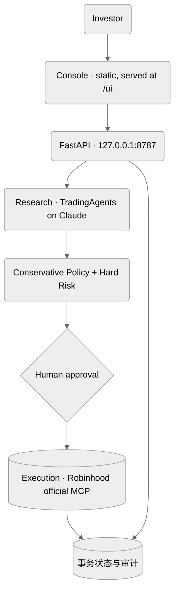

[English](README.md) | 简体中文

# Conservative Trading

一套为单个投资者设计的、保守的、必须人工批准的投资系统。

AI 研究流水线负责研究标的，确定性风控层决定什么被允许，任何动到钱的操作都由你批准。

`Python 3.12` · `FastAPI` · `仅限本机` · 真金执行默认关闭

[文档](docs/OPERATIONS.md) · [快速开始](#快速开始) · [前端交接](docs/FRONTEND_HANDOFF.md)

<br />



<sub>控制台运行在内置的示例数据上。顶部那条琥珀色提示正是产品在工作：示例数据永远不可能被误认成实时数据。</sub>

<br />

---

## 核心能力

**不交易也是一种结果**

这套系统的考核标准是保住本金，不是交易频次。队列安静意味着它看过了并选择放弃——这个结论会连同完整推理一起被记录下来。

**确定性风控，跑两遍**

规则层在提案时跑一次，在执行时再跑一次。它是纯 Python，不是模型，界面里没有任何东西能绕过它。

**批准的含义是「如果条件仍然成立」**

批准授权的是这个想法，而不是一张存好的订单。后端会重新读取报价、组合和风险状态，如果外部条件偏离太多就直接拒绝。

**三个互相隔离的资金池**

Core 和 Sandbox 是概念仓。Micro-Live 是 Robinhood 上的真金，被四道独立的机制限死在 $100。每个桶只能在自己的交易场所执行。

**每一个决策都留痕**

每次运行都会留下分析师报告、多空辩论、风险辩论和最终裁定。控制台把它们按顺序还原成一条完整轨迹。

<br />



<sub>一条提案：论据、盲区，以及它必须通过的每一条风控规则。</sub>

<br />



<sub>决策强度对照交易门槛，以及全部运行记录。</sub>

<br />

---

## 站在现成的东西上

这里没有重复造任何一个已经存在的轮子。

**[TradingAgents](https://github.com/TauricResearch/TradingAgents)** —— 多智能体研究框架。锁定到具体 commit，不 vendor、不修改。

**Claude Code CLI** —— LLM 运行时，跑在 Max 订阅上而不是按量计费的 API key。

**[Model Context Protocol](https://modelcontextprotocol.io)** —— 官方 Python SDK 把 TradingAgents 自己的数据工具暴露给该运行时，仅此而已。

**Robinhood Agentic Trading** —— 通过其官方 MCP server 使用，只作为确定性 Python 的券商传输层，绝不作为交给模型的工具。

**exchange-calendars** —— NYSE 的交易时段、假日和半日市，执行环节不依赖任何手工维护的日历。

**FastAPI** —— 选它是因为它会发布 OpenAPI schema；控制台是对着这份契约构建的，而不是对着一段文字描述。

<br />

---

## 技术栈

**后端**
Python 3.12 · FastAPI · Uvicorn · Pydantic

**研究**
TradingAgents · Claude Code CLI · Model Context Protocol

**券商**
Robinhood Agentic Trading（官方 MCP）· 模拟适配器

**存储**
SQLite 事务保存组合、风险、提案、审批、订单、成交与研究任务。
现有 YAML/JSON 文件只作为一次性迁移来源保留。

**控制台**
静态 HTML、CSS 和 JavaScript。无框架，无构建步骤。

**工具链**
uv · pytest · ruff

<br />

---

## 系统架构



研究层提出建议，风控层决定是否允许，你来批准。执行时会重新读取真实世界，并且仍然可能拒绝——拒绝是一个正确的结果，不是错误。

<br />

---

## 快速开始

### 环境要求

- Python 3.12
- [uv](https://docs.astral.sh/uv/)
- 已登录的 Claude Code CLI —— 研究运行时
- 一个 Robinhood 账户 —— 仅 Micro-Live 实验需要

### 安装

```bash
git clone https://github.com/<owner>/agentic_trading.git
cd agentic_trading
uv sync
```

### 环境变量

```bash
cp .env.example .env
cp state/portfolio.example.yaml state/portfolio.yaml
cp state/micro_live_portfolio.example.yaml state/micro_live_portfolio.yaml
```

`.env` 里所有的 key 都是可选的。不要设置 `ANTHROPIC_API_KEY` —— LLM 层跑在你的订阅上，设了 API key 会把计费切换成按量付费。

两个台账文件不纳入版本控制：它们记录的是你真实的持仓，仓库里只保留全现金的模板。

### 运行

```bash
uv run ct-api
```

```text
http://127.0.0.1:8787/ui/
```

API 和控制台是同一个进程、同一个源。OpenAPI schema 在 `/docs`。

命令行入口、券商连接和风控配置见[文档](docs/OPERATIONS.md)。

<br />

---

## 许可证

本仓库尚未声明许可证。在补充之前，作者保留所有权利。

TradingAgents 及其他所有依赖各自遵循其上游许可证。
