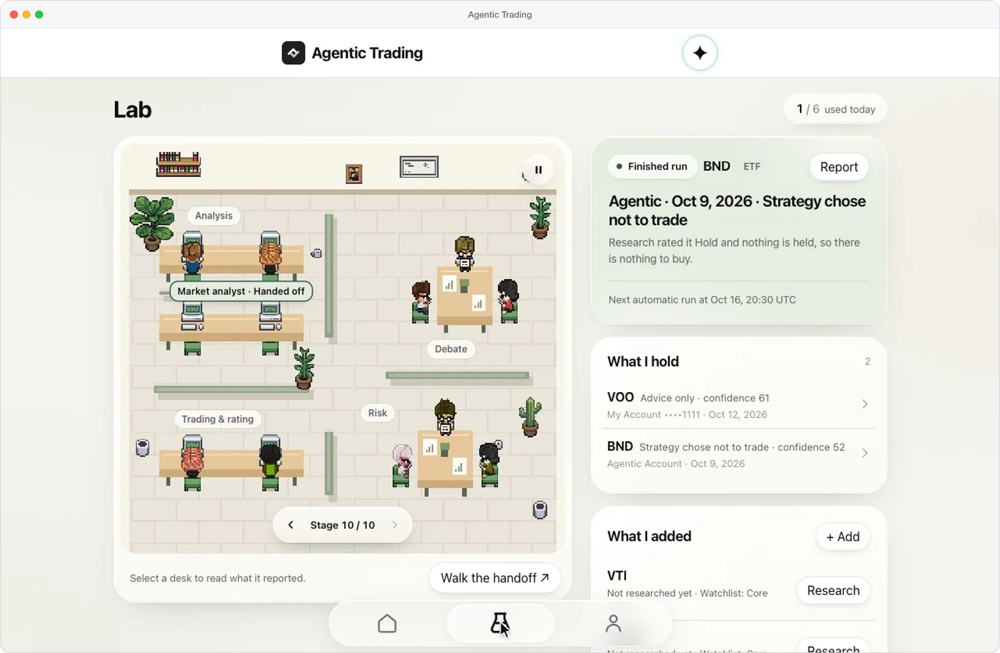
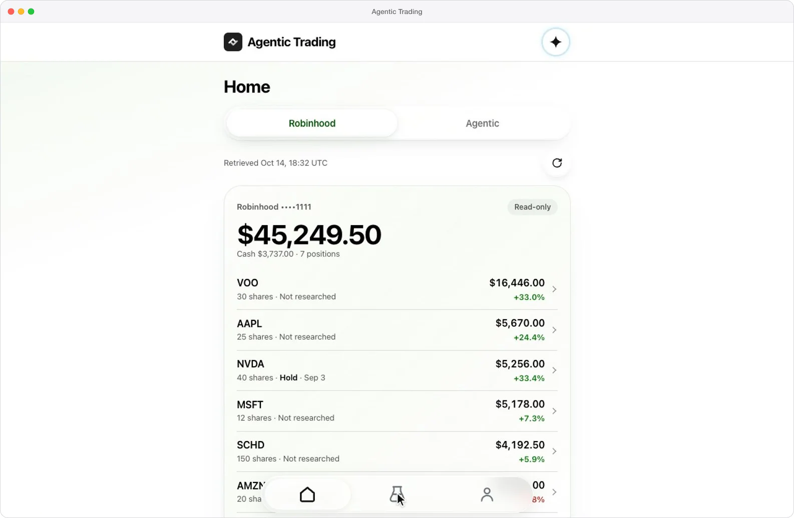

<div align="center">


# Agentic Trading

**多个 AI agent 研究并提出交易，能不能下单由确定性代码决定。**

基于开源 TradingAgents 研究图的交易系统。十二个 LLM agent 在收紧了权限的 Claude Code 运行时里研究一个标的；纯 Python 写的策略和风控规则把它们的结论变成提案，或者直接拒绝；你在手机优先的控制台上批准具体条款；执行前再全部核对一遍，然后才交给唯一能连到券商的适配器。

[](pyproject.toml)
[](pyproject.toml)
[](pyproject.toml)
[](agentic_trading/llm/claude_code.py)
[](deploy/macos)
[](.github/workflows/checks.yml)

[English](README.md) · **简体中文**

[技术亮点](#技术亮点) · [系统架构](#系统架构) · [技术栈](#技术栈) · [功能](#功能) · [本地开发](#本地开发)

</div>

<p align="center">
  
</p>

<p align="center"><sub>虚构的账户、研究和提案，由模拟 API 提供。办公室像素画来自 <a href="ui/assets/lab/pixel-agents/NOTICE.md">Pixel Agents</a>（MIT 许可）。</sub></p>

## 技术亮点

- **模型做研究，代码做决定。** TradingAgents 的十二个角色在 LangGraph 上辩论每个标的。它们的评级只有经过确定性的策略步骤和 39 条纯 Python 硬风控规则才能变成订单：每次都跑完全部规则，遇到任何异常或缺失输入直接拒绝；18 个离线风控场景全部通过。
- **批准的是条款，执行前重新核对。** 你批准的是某一版提案和固定的条款。下单前重新读取价格、现金、持仓、交易时段、回撤和市况，再跑一遍硬风控；17 个执行用例全部通过，其中重复提交也只发出一笔订单。
- **不能交易的模型运行时。** Claude Code CLI 被包装成 LangChain chat model，关闭内置工具并使用 `--strict-mcp-config`，agent 只能看到 MCP 数据工具。Robinhood 官方 MCP 服务器只作为确定性 Python 的传输通道；只要研究环境可能碰到券商工具，预检就拒绝动用真钱。
- **自动交易先在模拟里证明自己。** 你确认过的方案先在模拟账户里运行：同一套代码路径，独立的数据库，而且连不到真实券商。一个模式至少要有 30 个有效模拟交易日才能用真钱；新策略要满 180 个交易日并通过一次对比，才能替换正在运行的策略。
- **唯一的下单路径，全部离线测试。** 1,875 个 pytest 测试和 231 个前端用例都不连券商、不用凭据、不调模型；一个 AST 测试保证 `service/approvals.py` 是唯一能实盘下单的模块。

## 系统架构

<p align="center">
  
</p>

一次研究从控制台或每周的 launchd 定时任务发起，先进入 SQLite 队列。worker 通过 Claude Code CLI 运行 TradingAgents 研究图；组合经理的评级经过策略步骤和硬风控层，变成一份提案，或者一条记录在案的不交易理由。Web Push 把提案送到控制台；批准经由 `service/approvals.py` 执行：重新读取最新状态，再跑一遍硬风控和 15 项预检，然后才调用券商。

- **宁可不确定，也不重复下单。** 提交之前先写下订单意图和 client order id。超时或读不懂的回应会让订单停在 UNKNOWN 状态，等待与券商对账，绝不盲目重发；部分成交也如实记为部分成交。
- **不能离线使用。** Service Worker 只处理推送，没有 fetch handler，所以控制台从不显示缓存的价格，批准也不可能离线排队、等行情变了再重放。

## 技术栈

| 层         | 技术                                                             | 作用                                                                                                              |
| ---------- | ---------------------------------------------------------------- | ----------------------------------------------------------------------------------------------------------------- |
| Agent      | TradingAgents（固定 commit）· LangGraph · LangChain              | 十二个角色的研究图，原样使用；本项目补上持仓上下文、按标的类型选择分析师和模型路由                                |
| 模型运行时 | Claude Code CLI · MCP Python SDK                                 | 基于 `claude -p` 的 LangChain chat model；通过 MCP 提供 TradingAgents 的数据工具、SEC Form 4 文件和白名单网页抓取 |
| 决策       | Python 3.12 · Pydantic 2                                         | 策略映射、39 条硬风控规则、回撤阶梯、市况判断、仓位计算和执行前重新校验                                           |
| API        | FastAPI · Uvicorn                                                | 77 个路由，背后是 CLI 和定时任务共用的同一个 `service/` 层                                                        |
| 状态       | SQLite（WAL）· YAML · JSON                                       | 任务、提案、审批、订单、成交和账本存在同一个事务化存储里；`config/` 里是审阅过的配置                              |
| 数据与券商 | yfinance · FRED · SEC EDGAR · exchange-calendars · Robinhood MCP | 研究证据、纽交所交易时段、确定性代码背后的实盘券商，以及模拟券商                                                  |
| 控制台     | HTML · CSS · 原生 JavaScript · Web Push                          | 14 个页面，无构建步骤，中英双语，可以添加到手机主屏幕                                                             |
| 运维       | macOS launchd · zsh · uv                                         | 4 个定时任务、不可变版本发布与回滚、加密备份和心跳监测                                                            |
| 质量       | pytest · Ruff · node:test · Playwright                           | 离线测试套件、前端用例，以及在模拟 API 上运行的浏览器检查                                                         |

## 功能

### 研究、风控与审批

- **结合账户情况的研究。** 每次研究都带上这个资金桶的持仓、现金、回撤级别和市况。ETF 只安排市场和新闻分析师，个股四位分析师全部上场；每次模型调用和工具调用都有记录，研究室按工位把这次研究画出来。
- **规则只会收紧。** 策略步骤把评级映射成动作和仓位大小；随后硬风控检查现金、单仓和单笔上限、风险敞口重叠、价格和证据的新鲜度、事件静默期和每日限额，并把每条规则的结果连同依据的数字一起保存。模型再有把握，也不能放宽任何限制。
- **批准具体条款。** 提案按策略类别有自己的有效期：核心持仓两天，事件驱动的想法 45 分钟。批准会绑定提案版本和条款，并要求二次确认；授权一旦变化，就要重新确认。

两个离线脚本 `ct-risk-scenarios`（18 个场景）和 `ct-execution-scenarios`（17 个用例）的结果，全部符合预期：

| 硬风控场景                           | 结论 | 未通过的规则        |
| ------------------------------------ | ---- | ------------------- |
| 在所有限额内买入一只分散化 ETF       | 通过 | —                   |
| 已持有同一风险敞口组的基金，再买一只 | 拒绝 | HR09                |
| 个股超过股票仓位和行业上限           | 拒绝 | HR10 · HR11 · HR11b |
| 沙盒买入需要动用核心资金桶的现金     | 拒绝 | HR07 · HR07c        |
| 无法读取市况数据                     | 拒绝 | HR03                |
| 硬性暂停期间卖出以降低风险           | 通过 | —                   |

| 执行用例                            | 结果             | 发出的订单 |
| ----------------------------------- | ---------------- | ---------: |
| 批准后条件仍然成立                  | SUBMITTED        |          1 |
| 价格逆向波动 5%，超出 3% 的容忍区间 | REANALYZE        |          0 |
| 分析之后回撤阶梯升级                | INVALIDATED      |          0 |
| 提案时通过硬风控，执行时不通过      | REJECTED         |          0 |
| 同一个批准被执行两次                | ALREADY_EXECUTED |          1 |
| 分析途中触及 Claude 用量上限        | NO_PROPOSAL      |          0 |

这些用例都是合成数据，pytest 测试套件跑的也是同一批用例。它们证明软件按设计运行，不证明策略能赚钱；这一点只能由下面的前瞻记录来回答。

### 自动交易、风控与控制台

<p align="center">
  
</p>

<p align="center"><sub>同一个虚构账户和模拟 API。</sub></p>

**自动交易**

- 你只需确认一次边界：模式、可用资金，以及亏损到多少就停止开新仓。代码只能在这个边界内调整策略，每一次被截断都有记录。
- 模拟账户使用和实盘账户相同的规则、硬风控和执行代码，但写入自己的数据库；每笔模拟成交都要付假设的点差和滑点，再加上券商公布的费用。
- 回测只根据已经收盘的数据做决定，在下一个开盘价成交；有测试保证：改动某天之后的任何一根 K 线，都不会改变那天及之前的结果。

**风控与实盘**

- 每个资金桶有自己的账本和回撤阶梯，带回滞；进入硬性暂停后会一直锁定，直到有人写明理由手动解除。
- 实盘订单必须通过全部 15 项预检；资金上限被执行两次：一次在资金桶自己的账目里，一次在券商适配器里。
- 不在公司财报前开新仓，FOMC 和 CPI 发布日也不自动开仓；放一个空的 `state/HALT` 文件，就会阻止一切新开仓。

**控制台与设置**

- 三个标签页：首页看账户和需要你处理的事，研究室看研究，「我的」看记录和设置。每个读数都标明读取时间，过期了会直接说明。
- 设置页修改 `config/*.yaml`：每次修改都先预览；凡是放宽限制的修改，都要输入控制台密码并等待 24 小时，生效后提交到 git。
- 通过 Web Push 端到端加密地推送到主屏幕应用：有提案等待批准、研究失败或风险级别变化时通知你。

**前瞻评估**

- 一项研究开始时，为资金、标的范围、调度、风控配置和模型生成指纹，之后每份报告都会说明它们有没有变。
- 统计的不只是交易：「不交易」的决定、被拒绝或过期的提案、失败的研究都算在内。
- 收益按单位净值计算，入金永远不会被算成收益；对照基准在起始日一次性买入，并在同样的日期收到同样的入金。

## 本地开发

```bash
uv sync --frozen                         # 按锁定文件安装 Python 3.12 和依赖
mkdir -p state runs                      # 不入库：账本、审计数据库、研究产物
cp .env.example .env                     # 可选：FRED key、推送联系方式、心跳地址
uv run ct-auth                           # 设置控制台的 owner 密码
uv run ct-api                            # API 和控制台：http://127.0.0.1:8787/ui/
uv run ct-trigger manual --ticker VTI    # 用已登录的 Claude Code CLI 排一次研究
```

第一次运行 `ct-api` 之前，先把 `config/examples/` 里两份全现金的初始账本复制到 `state/`（见 [setup](docs/OPERATIONS.md#setup)）。`/ui/index.html?demo=1` 用示例数据展示控制台，不发任何 API 请求。研究需要已登录的 Claude Code CLI；不要设置 `ANTHROPIC_API_KEY`，适配器也会把它清掉。`config/` 是一个实际部署审阅过的配置，全新克隆没有券商令牌：连接账户之前，先读 [docs/OPERATIONS.md](docs/OPERATIONS.md)。

## 测试

```bash
deploy/checks.sh                         # Ruff、1,875 个 pytest 测试、231 个前端用例、密钥扫描
uv run ct-risk-scenarios                 # 以表格形式运行 18 个硬风控场景
uv run ct-execution-scenarios            # 17 个从提案到订单的用例
node tools/check_navigation.cjs          # 在移动端浏览器里用模拟 API 检查控制台导航
```

测试从不连接券商、不读凭据、不调用模型；任何测试只要碰到真实的状态数据库，`tests/conftest.py` 就会让它失败。CI workflow 和 `deploy/hooks/pre-push` 钩子运行的是同一个脚本；钩子还会用 API 的响应模型读一遍已存储的文档。浏览器检查需要 Playwright。

## 部署

```bash
deploy/macos/install.sh                  # 安装 4 个 launchd 任务：API、每周研究、备份、维护
deploy/macos/release.sh publish          # 把 HEAD 导出成不可变版本并切换过去
deploy/macos/release.sh rollback         # 把 current 指回上一个版本
uv run ct-state backup --verify          # 一致性 SQLite 备份，并做完整性检查
deploy/macos/selfcheck.sh                # 只读检查：重启之后是否一切都恢复了
```

版本发布、异地备份和手机访问见 [docs/MACOS_DEPLOYMENT.md](docs/MACOS_DEPLOYMENT.md)；审批、自动化和恢复见 [docs/OPERATIONS.md](docs/OPERATIONS.md)；控制台的设计见 [ui/README.md](ui/README.md)。
